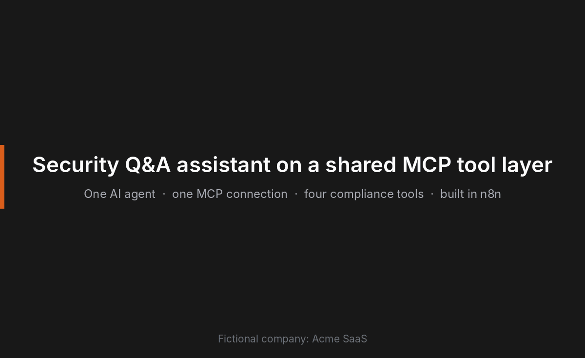
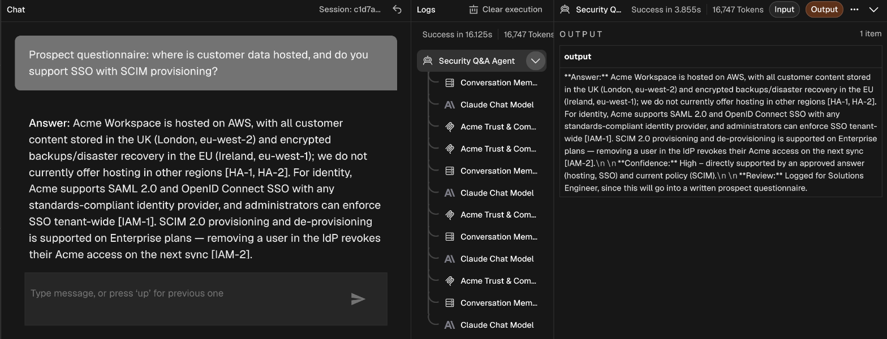
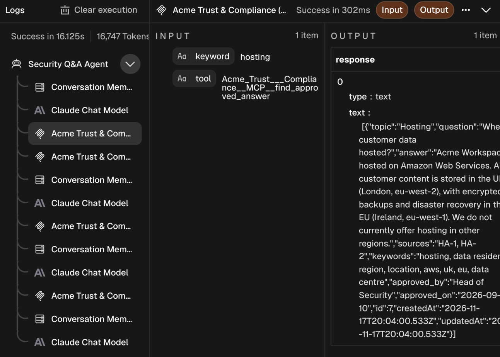
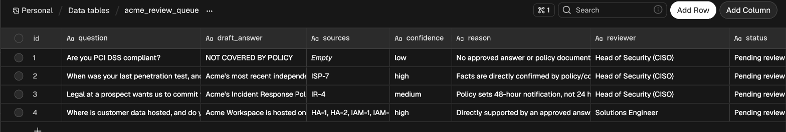
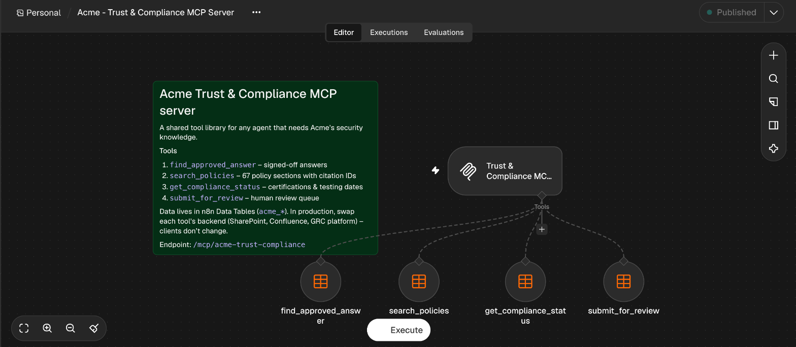
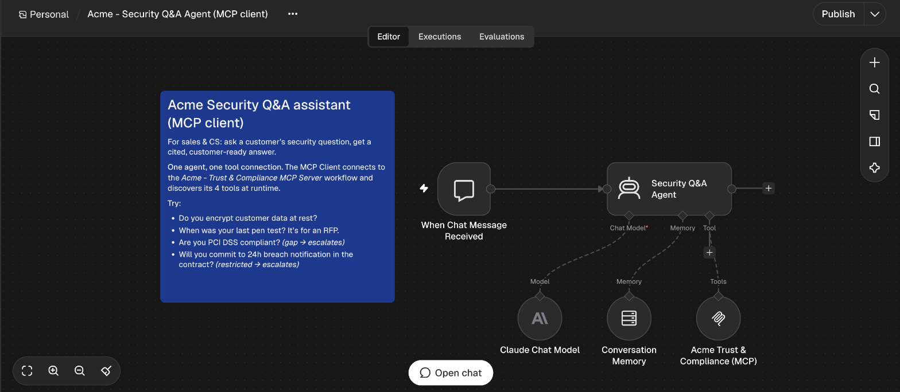
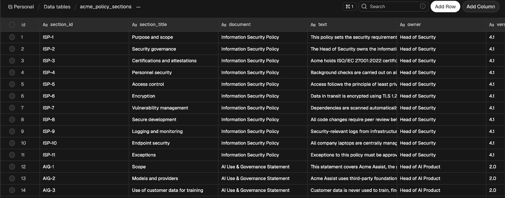
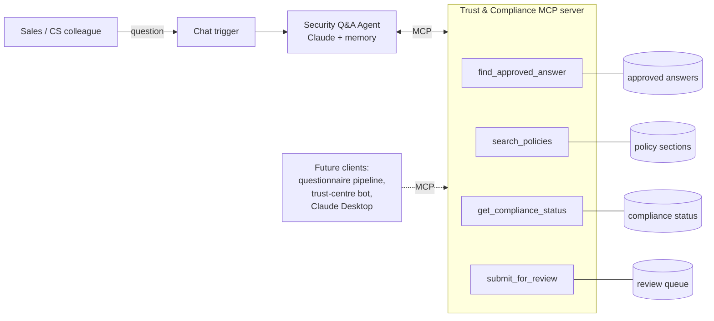

# Security Q&A assistant on a shared MCP tool layer (n8n)

A sales rep is on a call and the prospect asks, *"Do you encrypt data at rest? When was your last pen test? Can you commit to 24-hour breach notification?"* This project answers those questions in seconds, cites the policy behind every claim, and sends anything risky to a human before it reaches a customer in writing.

It is built as **one AI agent with one tool connection**: an MCP client that plugs into a separate **Trust & Compliance MCP server**. The server is the reusable part: a small library of compliance tools that any agent across the company can find and use.

> The company, policies and evidence are fictional ("Acme SaaS"). They reuse the policy pack from [ai-questionnaire-responder](https://github.com/jrzajko/ai-questionnaire-responder).

## Demo

**Asking a question.** A colleague pastes a prospect's questionnaire item. The agent answers with policy citations, rates its confidence and logs the answer for sign-off because it's going out in writing. The log on the right shows each MCP tool call it chose to make.

**Inside one tool call.** The agent called `find_approved_answer` over MCP with the keyword `hosting` and got back an answer the Head of Security had already approved.

**The review queue.** Anything written, uncertain or restricted lands here with its sources, confidence, reason and reviewer. Gaps and contractual asks go to the Head of Security; confident written answers go to the Solutions Engineer.

<b>The two workflows and the policy data</b>

**MCP server:** one MCP Server Trigger with four tools attached.

**Agent (MCP client):** chat trigger, Claude, memory, and a single MCP Client node. No tools are wired into the agent directly.

**Policy library:** the Acme policy pack as one row per section, so every claim can cite a section ID.

## Architecture

Two n8n workflows:

| Workflow | Role |
|---|---|
| `workflows/trust-compliance-mcp-server.json` | **MCP server.** An MCP Server Trigger with four tools, each backed by an n8n Data Table. |
| `workflows/security-qa-agent.json` | **MCP client.** Chat trigger → AI Agent (Claude Sonnet 5 + memory) → one MCP Client node pointing at the server. |

The agent has no tools wired into it. It connects to the server, receives the four tool descriptions, and Claude decides which to call for each question.

## The four tools

| Tool | Input | Returns | When the agent uses it |
|---|---|---|---|
| `find_approved_answer` | one keyword | Previously signed-off answers with sources, approver and date | Always first: reuse beats re-drafting |
| `search_policies` | one keyword, stem or section ID | Policy sections with citation IDs (e.g. `ISP-6`, `IR-4`) | No approved answer, or only partial coverage |
| `get_compliance_status` | none | Certifications, audits and testing with dates | Certifications, pen tests, DR / IR testing |
| `submit_for_review` | question, draft, sources, confidence, reason, reviewer | Review queue entry | Written answers, medium/low confidence, gaps, restricted topics |

**Routing rules** (in the agent's system prompt):
- **High confidence** (stated directly in an approved answer or policy): answer straight away. If it's going to a customer in writing, log it for the Solutions Engineer.
- **Medium / low confidence**, or a **restricted topic** (contract terms that differ from policy, SLAs, guarantees, liability, full pen test report, roadmap dates): log it for the Head of Security (CISO).
- **Not covered**: say so, don't guess.

## Why MCP here

Without a shared server, every assistant that needs security knowledge (sales, customer success, the questionnaire pipeline, a trust-centre bot) carries its own copy of the policy search and answer-library logic. When the policy store moves or a tool changes, you fix it in every copy.

With MCP:
- **One place to maintain.** Change a tool in the server and every connected client gets it on its next connection.
- **Any client.** The same server works with n8n agents, LangGraph, Claude Desktop or other MCP clients.
- **Backend-agnostic.** Today the tools read n8n Data Tables. In production each tool would read SharePoint, Confluence or a GRC platform; the clients don't change.

The trade-off: if only one agent ever used these tools, MCP would add setup for little gain. The value comes from the second and third clients.

## Results

Tested on four representative questions: an approved-answer hit, an RFP item needing evidence, a deliberate policy gap (PCI DSS) and a restricted contractual ask. All four were answered or escalated correctly, with citations, and three were logged for review. Full transcripts: [docs/sample-run.md](docs/sample-run.md).

## Set it up

You need an n8n instance (cloud or self-hosted, with Data Tables and the MCP nodes) and an Anthropic API key.

1. **Create four Data Tables** in n8n and import the CSVs from `data/`. All columns are strings.
   | Table name | Import from |
   |---|---|
   | `acme_policy_sections` | `data/policy_sections.csv` (67 rows) |
   | `acme_approved_answers` | `data/approved_answers.csv` (12 rows) |
   | `acme_compliance_status` | `data/compliance_status.csv` (7 rows) |
   | `acme_review_queue` | `data/review_queue_template.csv` (headers only) |
2. **Import `workflows/trust-compliance-mcp-server.json`** and publish it. Copy the MCP Server Trigger's **Production URL**.
3. **Import `workflows/security-qa-agent.json`**. In the *Acme Trust & Compliance (MCP)* node, replace `https://YOUR-N8N-INSTANCE/...` with the URL from step 2. Select your Anthropic credential on the *Claude Chat Model* node.
4. Click **Open chat** and try the prompts below.

The server uses no authentication so the demo is easy to run. For real use, switch the MCP Server Trigger to bearer or header auth and set the same credential on the client node.

## Demo script

| Ask | What to point out |
|---|---|
| "Quick one from a call: do you encrypt customer data at rest?" | Approved answer reused, cited, no review needed |
| "For an RFP: when was your last pen test, and can we send the full report?" | Agent combines policy and compliance evidence, and escalates the full-report request |
| "Are you PCI DSS compliant?" | Gap: says "not covered", doesn't guess, escalates |
| "Can we commit to 24-hour breach notification in the contract?" | Restricted: policy says 48h, so it's routed to the CISO |
| Open the `acme_review_queue` table | The human-in-the-loop record (tip: clear it before presenting so new rows appear live) |
| Open the server workflow | One library, four tools, any client |

## Data

`data/policy_sections.csv` is the Acme SaaS policy pack (10 documents) split into one row per section, so every claim can cite a section ID. The approved answers are worded directly from those sections. The compliance status dates are fictional but consistent with the policies. The pack deliberately leaves gaps (PCI DSS, FedRAMP, bug bounty, cyber insurance and others) to test that the assistant escalates instead of inventing answers.

## Limitations and next steps

- **Search is keyword substring matching.** Multi-word phrases can miss; the agent compensates by retrying with stems. Next: semantic search (embeddings) behind `search_policies`, without changing the tool's interface.
- **Confidence is the model's judgement plus rules,** not measured. The LangGraph [questionnaire responder](https://github.com/jrzajko/ai-questionnaire-responder) shows the measured approach (grounding checks, calibrated scoring, evals).
- **Reviewers aren't notified.** Next: email or Slack alert on new queue rows, and approved rows feeding back into `acme_approved_answers`.
- **Second client.** Point the questionnaire responder (LangGraph supports MCP clients) or Claude Desktop at the same server to show reuse.
