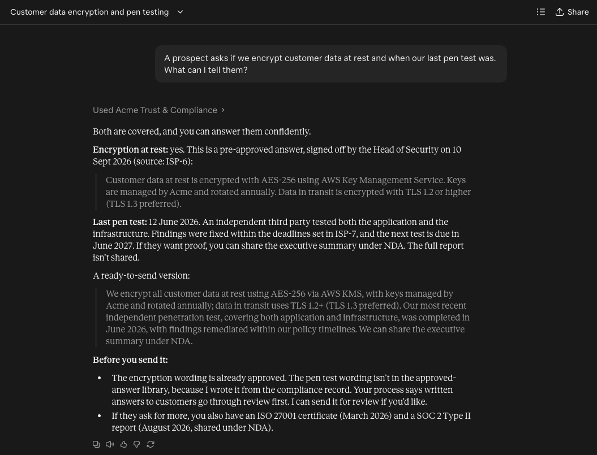

# Sample run

Four questions covering the four behaviours the assistant needs: reuse an approved answer, combine policy and evidence for a written reply, admit a gap, and escalate a restricted request. Outputs are copied from n8n executions (Claude Sonnet 5, November 2026).

| # | Question | Tools the agent chose | Confidence | Routed to |
|---|---|---|---|---|
| 1 | Quick one from a call: do you encrypt customer data at rest? | `find_approved_answer("encrypt")` | High | Not needed (verbal, high confidence) |
| 2 | For an RFP: when was your last penetration test, and can we send them the full report? | `get_compliance_status`, `find_approved_answer("pen test")` → no match, `search_policies("penetration")`, `submit_for_review` | High facts, restricted ask | Head of Security (CISO) |
| 3 | A prospect asks: are you PCI DSS compliant? | `find_approved_answer("PCI")`, `search_policies("PCI")`, `search_policies("payment")`, `find_approved_answer("payment")` → nothing, `submit_for_review` | Low | Head of Security (CISO) |
| 4 | Legal at a prospect wants us to commit to breach notification within 24 hours in the contract. Can we say yes? | `find_approved_answer("breach notification")` → no match, `search_policies("notif")` → IR-4, `submit_for_review` | Medium, restricted | Head of Security (CISO) |

A fifth question was asked live in the n8n chat for the README screenshots: *"Prospect questionnaire: where is customer data hosted, and do you support SSO with SCIM provisioning?"* The agent reused approved answers (`hosting`, `sso`), checked SCIM in policy, answered with [HA-1, HA-2, IAM-1, IAM-2], rated it high, and logged it for the Solutions Engineer because it was going into a written questionnaire.

## Replies

**1. Encryption at rest**
> **Answer:** Yes. Customer data at rest is encrypted using AES-256 via AWS Key Management Service, with keys managed by Acme and rotated annually. Data in transit is encrypted with TLS 1.2 or higher (TLS 1.3 preferred). [Approved answer, Head of Security, 2026-09-10 / ISP-6]
> **Confidence:** High – directly confirmed by an approved answer and policy citation.
> **Review:** Not needed (quick verbal question, high confidence).

**2. Pen test for an RFP**
> **Answer:** Acme's most recent independent third-party penetration test of the application and infrastructure was completed on **12 June 2026**, with all findings remediated within our standard ISP-7 targets (critical: 7 days, high: 30 days, medium: 90 days) [ISP-7, Compliance status]. The full report is **not** shared externally; an executive summary of the latest test is available to customers under NDA [ISP-7].
> **Confidence:** High – directly confirmed by policy and current compliance status.
> **Review:** Logged for Head of Security (CISO) — required because this goes to a customer in writing (RFP) and touches the restricted topic of sharing the full pen test report.

**3. PCI DSS (deliberate gap in the policy pack)**
> **Answer:** Not covered by Acme policy – escalated to the Head of Security. I could not find any approved answer or policy documentation confirming PCI DSS compliance status, so I can't confirm this to the prospect at this time.
> **Confidence:** low – no evidence found in approved answers or policy documents.
> **Review:** Logged for Head of Security (CISO).

**4. 24-hour breach notification in the contract (restricted)**
> **Answer:** Acme's standard policy commits to notifying affected customers of a confirmed personal data breach without undue delay, and in any case within 48 hours of confirmation [IR-4] — not 24 hours. We cannot commit to a 24-hour contractual SLA as this falls outside our documented policy and is a contractual term that must be reviewed by the Head of Security/Legal before agreeing with the prospect.
> **Confidence:** medium – policy states 48 hours, not 24, and this is a contractual commitment (restricted topic) requiring sign-off.
> **Review:** Logged for Head of Security (CISO).

## Review queue after the run

| question | confidence | sources | reviewer | status |
|---|---|---|---|---|
| Are you PCI DSS compliant? | low | – | Head of Security (CISO) | Pending review |
| When was your last penetration test, and can we send them the full report? | high | ISP-7 | Head of Security (CISO) | Pending review |
| Legal at a prospect wants us to commit to breach notification within 24 hours… | medium | IR-4 | Head of Security (CISO) | Pending review |

## Second client: Claude

The same MCP server added to Claude as a custom connector (see the README), with only that connector switched on. Question: *"A prospect asks if we encrypt customer data at rest and when our last pen test was. What can I tell them?"*

**Same as the n8n agent**
- Same facts and citations: AES-256 via AWS KMS [ISP-6] from the approved answer, and the pen test on 12 June 2026 from the compliance record [ISP-7].
- Same guardrails: the full pen test report isn't shared, only the executive summary under NDA.
- It followed the server's instructions (approved answers first, compliance record for dates, written answers need review) without having the n8n agent's system prompt.

**Different, and why**
- **It separated approved wording from its own drafting.** It flagged that the encryption text is pre-approved but the pen test sentence was written from the compliance record.
- **It asked before logging for review** rather than calling `submit_for_review` automatically. The n8n agent's prompt tells it to log straight away; Claude, without that instruction, treated writing to the queue as an action to confirm first.
- **Different format.** The Answer / Confidence / Review layout lives in the n8n agent's prompt, not the server. To make it consistent across clients, move it into the server instructions.
- **Extra context.** It volunteered ISO 27001 and SOC 2 from the same compliance call.

**Takeaway:** two different AI clients, one shared tool library: same facts, same citations, same guardrails, nothing rebuilt. Rules in the server apply everywhere; rules in an agent's prompt apply only to that agent.

## Observations
- The agent picked different tool combinations per question; nothing in the workflow fixes the order.
- It never invented a PCI answer: two keyword searches in each source came back empty, so it escalated.
- Multi-word keywords (`"breach notification"`) miss the approved-answer table because search is a simple substring match. The agent recovered by searching policies with a stem. Semantic search is the obvious upgrade (see README).
